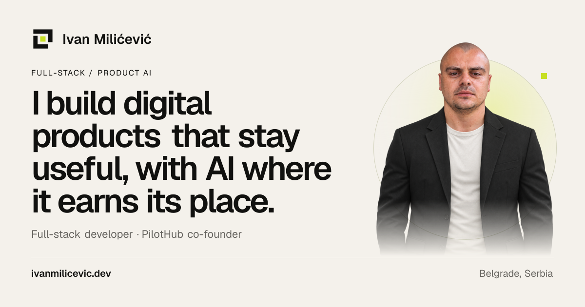
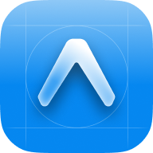
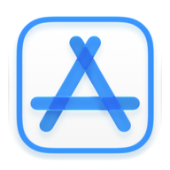

**[Portfolio ↗](https://ivanmilicevic.dev)** &nbsp;·&nbsp; **[CV / PDF ↓](assets/ivan-milicevic-cv.pdf)** &nbsp;·&nbsp; **[LinkedIn ↗](https://linkedin.com/in/ivan-milicevic993)** &nbsp;·&nbsp; **[Email ↗](mailto:ivanmilicevicmeda@gmail.com)**

Full-stack developer building product systems, agent interfaces, and AI-powered workflows across React, Next.js, and modern data stacks.

### Current work

| Company | Work | Region |
| :-- | :-- | :-- |
| **[PilotHub Studio](https://pilothub.us/)** | Co-Founder & Senior Developer. Custom web applications, AI integrations, CMS platforms, and APIs. | US |
| **[Munich General Insurance Services GmbH](https://www.mobilversichert.de/)** · mobilversichert | Insurance software connecting brokers, insurers, and policyholders through digital customer, policy, and document workflows. | EU · Germany |
| **Magic Digs** | Product engineering for real-estate agent websites, shared dashboards, and integrated AI assistants. | US |

Previously: **TradeCore** (EU), **PRODYNA** (EU), and **Self Employed** (EU–US).

### Products

| Product | What it does |
| :-- | :-- |
| **[WeddList](https://weddlist.dev/)** | A wedding planning product for web, iOS, and Android, covering guest lists, RSVP tracking, groups, gifts, and budgets. |
| **[EdPilotHub](https://edpilothub.com/)** | An education-focused CMS that brings school websites, events, applications, accessibility, and AI engagement tools into one platform. |
| **Bebio** | An iOS and Android parenting app with offline-first sync and an AI assistant. |
| **[Tandem](https://github.com/ivanmeda993/tandem)** | A developer tool connecting Claude Code and Codex for collaboration, code reviews, and parallel work. |
| **Inertia** | A personal finance product for spending insights and financial goals, across web and mobile. |
| **[IPS Uplatnica](https://www.ipsuplatnica.com/)** | A privacy-conscious PWA for saving payment templates and generating NBS IPS QR codes, with offline support. |

**Further client work**

[Ukandu](https://pilothub.us/projects/ukandu) · [Miami Arts Charter School](https://miamiartscharter.net/) · [Halliday Financial](https://pilothub.us/projects/halliday-financial) · Olsen Ziegler Realty · DentalHolist · [Easy Florida Online Divorce](https://pilothub.us/projects/easy-florida-online-divorce)

[Explore the full portfolio ↗](https://ivanmilicevic.dev/#work)

### Technologies

&nbsp; &nbsp; &nbsp; &nbsp; &nbsp; &nbsp; &nbsp; &nbsp; &nbsp; 
&nbsp; &nbsp; 

| Area | Tools |
| :-- | :-- |
| **Languages & applications** | TypeScript · JavaScript · React · Next.js · Angular · Vue.js · React Native · Expo |
| **Interfaces & state** | Tailwind CSS · shadcn/ui · TanStack Query · Redux · React Hook Form · Formik · Material UI · Lexical |
| **Backend & content** | Node.js · Express · Bun · Elysia · Hono · Better Auth · Payload CMS · Sanity |
| **Data & storage** | PostgreSQL · MongoDB · Neon · Supabase · Convex · PowerSync · Drizzle · Prisma · Amazon S3 · Vercel Blob |
| **AI & agents** | OpenAI · AI SDK · AI Gateway · Pinecone · eve · LM Studio · Hermes Agent · n8n |
| **Delivery & infrastructure** | Vercel · Coolify · Expo Services (EAS) · App Store Connect · Google Play Console · Turborepo · GitHub Actions · GitLab CI · Azure IoT Hub · Resend · Sentry · Vitest |

### Connect

[Email](mailto:ivanmilicevicmeda@gmail.com) · [LinkedIn](https://linkedin.com/in/ivan-milicevic993) · [X](https://www.x.com/m_ivan_993) · [Instagram](https://www.instagram.com/ivanmeda993) · [Discord](https://discord.com/users/meda_bbdk)
